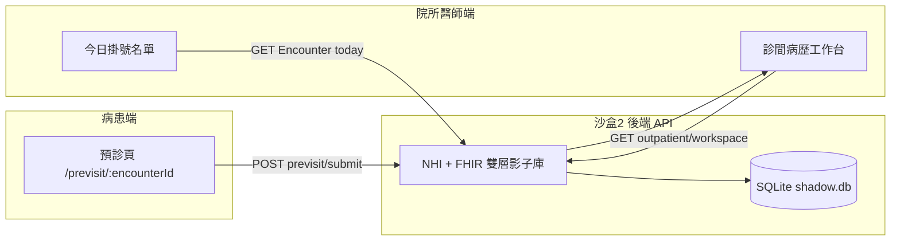

# Wundadi 次世代 FHIR HIS — 開發者手冊與設計指南

本手冊為 Wundadi 醫療系統開發的權威指南之一。  
**產品原則、功能畫線、Cursor 前提、一人公司邊界**以  
`docs/專案憲章-原則與方向.md` 為準（換 Model／新對話必讀）。  
本手冊偏重沙盒架構、API、UI 與路線圖表。

---

## 📖 目錄
0. [〇、專案憲章（必讀）](#〇專案憲章必讀)
1. [一、產品願景與路線圖 (Roadmap)](#一產品願景與路線圖-roadmap)
2. [二、三沙盒解耦架構 (Sandboxes)](#二三沙盒解耦架構-sandboxes)
3. [三、門診閉環流程與 API 契約 (Clinic Flow & APIs)](#三門診閉環流程與-api-契約-clinic-flow--apis)
4. [四、診間 UI 佈局、欄位與快捷鍵 (UI Spec & Shortcuts)](#四診間-ui-佈局欄位與快捷鍵-ui-spec--shortcuts)
5. [五、UI 模組化與自定義開發規範 (Coding Standards)](#五ui-模組化與自定義開發規範-coding-standards)

---

## 〇、專案憲章（必讀）

| 文件 | 用途 |
|------|------|
| `docs/專案憲章-原則與方向.md` | A/B/C 分層、資料權、Hub–Spoke、申報、Cursor 前提、禁止 VPN 自動化 |
| `docs/診所端-用Cursor處理時令專案.md` | 診所如何用 Cursor |
| `開啟-用Cursor問本專案.bat` | 一鍵用 Cursor 開本專案 |

**定案句：** 主幹我們做穩；資料在診所；時令專案診所＋Cursor 自助；人只被事件叫醒；一人公司不當健保專案客服。

---

## 一、產品願景與路線圖 (Roadmap)

### 1. 北極星指標
**Wundadi** 是以 **SMART on FHIR** 為底座的獨立醫療系統，最終目標是**全面取代**現有「醫聖看診／申報系統」。院方現有的「醫美相片知識庫」將保留其最適合的相簿流程與 UI，經由資料對接模組融入 Wundadi 新核心中。

### 2. 三層路線圖

```
Layer A  新核心（本 repo · 三沙盒）     ← 現行開發主線 · 門診閉環 v0.11
Layer B  醫美知識庫對接（Adapter）      ← 待院方整理程式／結構後開工
Layer C  取代醫聖 + 正式上線            ← Phase 4 申報/讀卡 + 維運法遵
```

### 3. 開發進度與 Jira 對照表

| 能力 | 狀態 | Jira | 備註 |
|------|------|------|------|
| Local-First SQLite 雙層 FHIR | 已 PoC | KAN-2, KAN-16 | 本機影子庫架構 |
| 門診閉環（讀卡→掛號→預診→工作台） | 已 E2E 驗收 | KAN-20 | 核心看診日流程完成 |
| 病灶 FHIR Media | 已 PoC | KAN-18 | 皮膚科圖像資源落庫 |
| 沙盒 1 API 閉環 | 已 PoC | KAN-21 | 前端可手動切換對接後端 |
| SMART / FIDO2 | 未開 | KAN-1 | 去中心化身分驗證核心 |
| GCP 正式上雲 | 未開 | KAN-11 | 加密傳輸與雲端落地 |
| 健保 XML 申報 | 組檔模組已開工（過渡 XML） | KAN-6 | `src/claims/`；藥費＝開藥快照單價×量；正式署方 schema 待換 |
| 醫美知識庫對接 | 規劃中 | KAN-24 | 待院方提供舊資料結構後開工 |
| 唯讀歷史資料政策 | 規劃中 | KAN-25 | 病歷與 Media 僅允許 POST/PUT，禁止 DELETE |
| Hub–Spoke 無感更新（藥價／規則 Pack） | Spoke + Hub 管線已落地 | — | 契約：`docs/Hub-Spoke無感更新與人力介入契約.md`；Spoke：`/sync/packages/*`；Hub：`hub/`、`scripts/tools/啟動-Hub-健保用藥Pack發布.bat` |
| 時令專案／計畫組檔 | 以 Cursor 自助為前提 | — | 不進標準客服；`docs/診所端-用Cursor處理時令專案.md`、`開啟-用Cursor問本專案.bat` |

---

## 二、三沙盒解耦架構 (Sandboxes)

為了提升開發效率並實現個別元件的獨立驗收，系統全面解耦為三個沙盒環境，禁止跨沙盒的隱性耦合。

```
                    ┌───────────────────────────────────────┐
                    │      沙盒 1：前端 UI (Mock)            │
                    │      - 目錄: frontend/                │
                    └──────────────────┬────────────────────┘
                                       │ (透過 VITE_ENABLE_API 切換)
                                       ▼
┌──────────────────────────────────────┴──────────────────────────────────────┐
│                  沙盒 2：後端 FHIR API & SQLite 雙層影子庫                   │
│  - 目錄: src/api/, src/infrastructure/                                      │
│  - 雙層貼紙: resource_cache (完整 JSON) + *_index (快取查詢貼紙)            │
└──────────────────────────────────────┬──────────────────────────────────────┘
                                       ▲
                                       │ (透過 REST/Web API 進行數據餵送)
                    ┌──────────────────┴────────────────────┐
                    │      沙盒 3：健保讀卡機 (獨立工具)      │
                    │      - 目錄: utils/nhi_reader.py       │
                    └───────────────────────────────────────┘
```

### 1. 沙盒 1 — 前端 UI
*   **目錄**：`frontend/`
*   **日常啟動**：雙擊根目錄 `啟動-Wundadi門診.bat` → 畫面 http://127.0.0.1:3010（接後端 :5000）
*   **純 Mock（不連後端）**：`cd frontend && npm run dev`（不要設 `VITE_ENABLE_API`）

### 2. 沙盒 2 — 後端 FHIR API
*   **目錄**：`src/api/`、`src/infrastructure/`
*   **日常啟動**：同上，`啟動-Wundadi門診.bat` 會一併開後端
*   **只開 API**：`scripts\start_api.bat` → Swagger http://127.0.0.1:5000/docs
*   **特色**：實作**雙層貼紙儲存結構**。寫入時同時更新完整 FHIR `resource_cache` 表，以及供 SQL 索引檢索的快取貼紙表（如 `patient_index`、`encounter_index` 等）。
*   **診斷端點**：`GET /sandbox/dual-layer/{type}/{id}` 可返回雙層落庫對照結果。

### 3. 沙盒 3 — 健保讀卡（獨立工具）
*   **目錄**：`utils/nhi_reader.py`（硬體連線診斷）
*   **正式生產線**：對接健保署官方「讀卡機控制軟體 6.0」本機主控台（`http://localhost:5066`）與 VPN 業務端 API。
*   **硬體診斷**：`python utils/nhi_reader.py pcsc`（依賴 `pyscard`）。
*   **原則**：獨立運作，**禁止**被 FastAPI 後端直接靜態 import 或被 React 前端 import，以保持硬體適配層與業務層的物理隔離。

---

## 三、門診閉環流程與 API 契約 (Clinic Flow & APIs)

Wundadi 實現了「院所、醫師、病患」三方數位閉環，使看診前的病患自訴、看診中的醫師決策、與看診後的健保申報檔案自動流動。

### 1. 三角色閉環模型



### 2. 後端 NHI 進場與看診自動驗收端點（Swagger 規範）

| 步驟 | API 端點 | 說明與欄位規格 | 驗收指令檔 |
|------|----------|----------------|------------|
| **1. 讀卡註冊** | `POST /nhi/v1/patient/register` | `idNo` (身分證，1 英文 + 9 數字)<br>`birthday` (民國 YYYMMDD)<br>`sex` (`M` / `F`) | `scripts/验收/測試-沙盒2-讀卡橋接患者進場-自動驗收.bat` |
| **2. 掛號進場** | `POST /nhi/v1/encounter/register` | 建立當次就醫實體 (Encounter)，設定號碼與 finished/waiting 狀態。 | `scripts/验收/測試-沙盒2-門診一日閉環-自動驗收.bat` |
| **3. 過敏記錄** | `POST /nhi/v1/allergy/register` | `patientIdNo` (病患身分證)<br>`snomedCode` (過敏原代碼)<br>`rxnormSubstance` (化學成分) | `scripts/验收/測試-沙盒2-過敏Allergy-自動驗收.bat` |
| **4. 病患預診** | `POST /nhi/v1/previsit/submit` | 病患自訴。更新 `Encounter.reasonCode` 與 `preVisitCompleted` 狀態。 | `scripts/验收/測試-沙盒2-門診閉環-自動驗收.bat` |
| **5. 醫師 SOAP** | `POST /nhi/v1/soap/register` | `encounterId` (當次就診)<br>`chiefComplaint` (主訴，必填)<br>`subjective` / `objective` / `assessment` / `plan` | `scripts/验收/測試-沙盒2-健保SOAP門診紀錄-自動驗收.bat` |
| **6. 生命徵象** | `POST /nhi/v1/observation/register`| `vitalType` (`body_temperature`, `heart_rate`, `systolic_bp`, `diastolic_bp`, `body_weight`) | `scripts/验收/測試-沙盒2-生命徵象Observation-自動驗收.bat` |
| **7. 診斷與處方**| `POST /nhi/v1/condition/register`<br>`POST /nhi/v1/medication/register` | **診斷**：對應 ICD-10 診斷與 ICD-9 對照 GEM 表。<br>**處方**：寫入 `MedicationRequest`，對應台灣健保碼與 RxNorm 碼。 | `scripts/验收/測試-沙盒2-診斷處方NHI進場-自動驗收.bat` |
| **8. 病灶影像** | `POST /nhi/v1/media/register` | `siteLabel` (部位標記)<br>`imageBase64` (Base64 圖檔，自動關聯) | `scripts/验收/測試-沙盒2-病灶Media-自動驗收.bat` |

### 3. 醫師看診工作台一次性拉取 (Workspace Data Contract)
當醫師雙擊病人進入看診時，前端會呼叫聚合端點：`GET /nhi/v1/outpatient/workspace/{encounterId}`。
該端點會一次性回傳以下資料契約：
*   `queueMeta`：診間號碼、候診狀態、預診完成旗標、過敏警示旗標。
*   `patient`：FHIR Patient 資源。
*   `encounter`：當前掛號資源。
*   `chiefComplaint`：病患自訴/主訴。
*   `allergies`：歷來確診之過敏清單。
*   `soap`：當次病歷 SOAP 結構。
*   `vitals`：當次體溫、血壓、體重等數據。
*   `diagnoses`：當次診斷清單。
*   `currentMedications`：當前開立處方。
*   `previousMedications`：前次看診處方（含 `previousEncounterId`，供一鍵複製）。
*   `lesionMedia`：病患歷史與當前病灶縮圖與照片資料。

---

## 四、診間 UI 佈局、欄位與快捷鍵 (UI Spec & Shortcuts)

Wundadi 專門為皮膚科診間習慣設計了**雙欄版面**。前次處方與病灶照片等關鍵臨床資訊固定放在中欄，而非大醫院繁瑣的三欄式側邊看板。

### 1. 皮膚科雙欄工作站佈局 (1920×1080)

```
┌────────────────────────────────────────────────────────────────────────────┐
│ 頂部：診間 | 醫師 | 今日掛號 N | 候診 n | 看診中 1 | Local-First 同步狀態   │
│ (ClinicWorkspaceHeader)                                                    │
├─────────────┬──────────────────────────────────────────────────────────────┤
│ 左欄 240px  │ 中欄（主病歷區域 — 滾動工作區，CSS Grid 12欄位）                 │
│ 今日掛號列表 │ ┌─ ① 過敏警示帶（sticky 紅字 - AllergyBannerWidget）──────────┐  │
│ (可收合)     │ ├─ ② 病患標題列 (PatientHeaderWidget) ────────────────────────┤  │
│             │ ├─ ③ 病灶照片區（固定 - LesionPhotosWidget）★ 皮膚科靈魂 ────┤  │
│             │ │     [縮圖時間軸]  +  點選放大 HD 對照                     │  │
│             │ ├─ ④ 主訴 CC / PE 編輯區 (ChiefComplaintWidget) ──────────────┤  │
│             │ ├─ ⑤ 診斷區 (DiagnosesWidget) ────────────────────────────────┤  │
│             │ ├─ ⑥ 前次處方（唯讀）+【一鍵複製前次處方】★ ────────────────┤  │
│             │ └─ ⑦ 當前處方 MedicationRequest (CurrentRxWidget + 快捷命令列)─┘  │
│             │ (ConsultationGrid 組件插槽)                                  │
├─────────────┴──────────────────────────────────────────────────────────────┤
│ 右欄（可收合 200px）：僅 套餐捷徑 | 常用 ICD | 完成看診 — 無前次處方、無照片  │
└────────────────────────────────────────────────────────────────────────────┘
```

**明確禁止：**
*   ❌ 前次處方放右欄（醫師對比視線會被打斷）。
*   ❌ 病灶照片放右欄或彈窗底層（醫師需要一邊看病歷，一邊看前次照片對照紅腫消退情況）。

### 2. 鍵盤快速鍵定義
為了讓診間醫師能以最快速度操作，系統原生綁定鍵盤快捷鍵：

| 快捷鍵 | 觸發動作 | 說明 |
|--------|----------|------|
| **F2** | `queueList` / 返回大廳 | 返回今日掛號清單首頁 |
| **F3** | `clinicMain` / 主病歷區 | 將焦點移回並滾動至主病歷與 SOAP 區 |
| **F4** | `historyChart` / 歷史處方 | 將焦點移至右側歷史處方看板 |
| **F5** | `clinicalAlerts` / 警示面板 | 彈出詳細臨床警示與過敏原細節 |
| **F7** | `dittoRx` / 一鍵複製前次 | 自動將前次處方完全複製至當前處方草稿（自動重新運行防過敏 CDSS） |
| **F8** | `lesionPhoto` / 病灶照區 | 直接滾動並聚焦至病灶影像區，可點選相機拍照 |
| **F9** | AI 設計師 drawer | 打開 / 關閉 AI 介面自定義抽屜 |
| **F10**| 完成看診 | 標記當前 Encounter 為 finished，保存處方，退出工作台回到候診大廳 |
| **Escape**| 關閉彈窗 / 退出 | 依序關閉 alerts 彈窗、AI 抽屜或退出至主選單 |

---

## 五、UI 模組化與自定義開發規範 (Coding Standards)

為了實現讓使用者能輸入 AI 指令（如「放大開藥區」、「將掛號欄移到右邊」）而不損壞任何功能，介面層實施了嚴格的 **「配置驅動（Config-Driven Layout）」** 機制。

### 1. 三層開發解耦規範
所有前端介面的調整與實作必須嚴格遵守以下三層的解耦限制，防錯死鎖：
*   **配置層 (`ui-config.json` / `localStorage`)**：定義每個元件在 Grid 中的 `x`、`y`、`w` (width)、`h` (height) 座標、可見度 (`visible`) 及主色調。
*   **排版層 (`ClinicOutpatientPage.tsx`)**：
    *   負責讀取配置檔，動態生成 Grid CSS 外框。
    *   擔任全域狀態 Orchestrator。負責從 `useClinicWorkspace` 拉取 API 資料，透過 `Props` 分發給小元件。
    *   **主頁面之外的任何 Widget 元件內部絕對禁止直接呼叫後端 API，也禁止內部自創全域臨床狀態**。
*   **元件層 (`src/components/clinic/widgets/`)**：
    *   獨立的功能小模組（例如 `ChiefComplaintWidget.tsx`、`CurrentRxWidget.tsx`）。
    *    Widget 最外層一律設為 `className="flex flex-col h-full w-full overflow-hidden min-h-0"`。它們必須像水一樣，自動填滿外層 Grid 容器，**不得寫死任何絕對寬高值**。

### 2. 新增診間功能檢查清單 (Checklist)
當開發者或 AI 設計師需要在看診桌上新增一個功能版塊（如：生理指標趨勢圖）時，必須完成以下檢查：
*   [ ] **1. 設計 Widget**：在 `src/components/clinic/widgets/` 下建立 `MyNewFeatureWidget.tsx`。
*   [ ] **2. 限制外觀**：最外層使用 `w-full h-full min-h-0`，使之可任意拉伸。
*   [ ] **3. 宣告 Props**：只接收需要的資料陣列及更新回呼，不進行 API 呼叫。
*   [ ] **4. 註冊 ID**：在 `src/types/uiConfig.ts` 中將新元件名稱加入 `LayoutComponent` 的 ID Union Type。
*   [ ] **5. 設定預設值**：在 `ui-config.json` 或 `useDefaultUiConfig.ts` 中給予它一組預設的 Grid 座標與初始可見度。
*   [ ] **6. 綁定排版**：在 `ClinicOutpatientPage.tsx` 的 `renderComponent` 函式中加入該元件 Case 與插槽渲染。
*   [ ] **7. 測試編譯**：執行 `npm run build`，確保 TypeScript 編譯成功。
